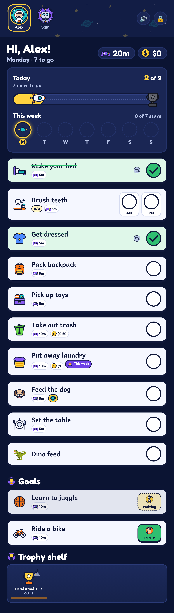
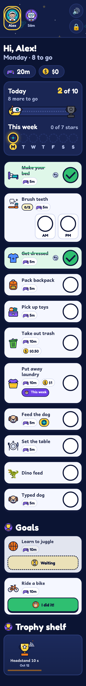
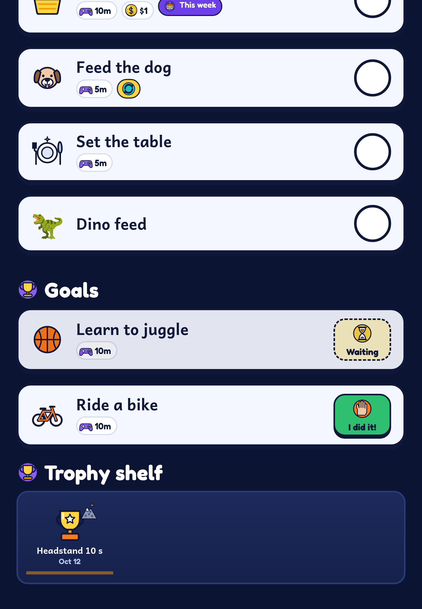
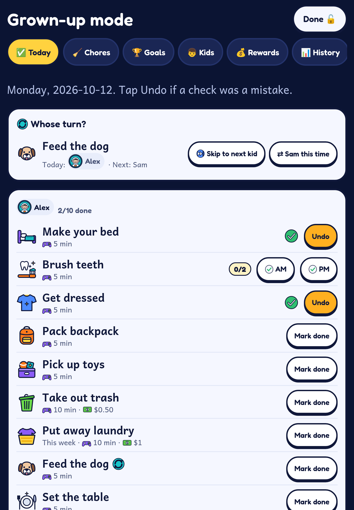
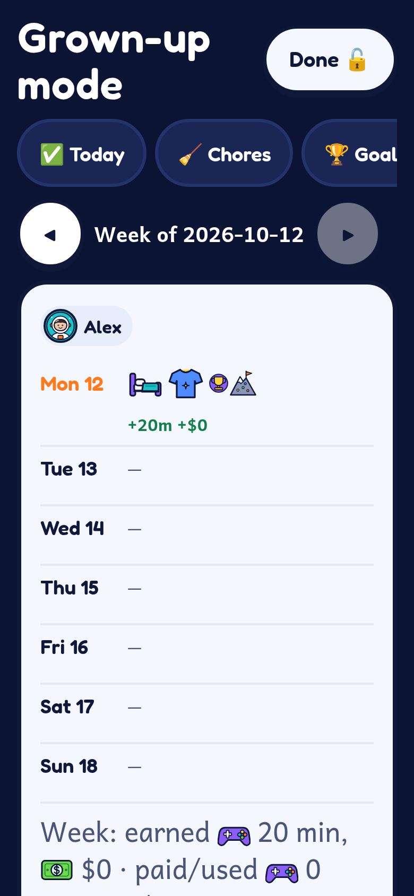

# Chore Quest

A kid-friendly chore tracker for a shared family iPad (or any phone/tablet). Kids tap their avatar, check off chores, watch their progress rocket fill up, and earn screen time, money and trophies. Grown-ups manage everything behind a PIN. Runs as an installable PWA on **Cloudflare Pages + Pages Functions + D1** — free tier friendly, no servers to run.

| iPad | iPhone |
|---|---|
|  |  |
|  |  |
|  |  |

More: [parent chore list](docs/screenshots/ipad-p-04-parent-chores.png), [weekly history](docs/screenshots/ipad-p-08-parent-history.png), [iPad landscape](docs/screenshots/ipad-l-01-kid-today.png). Screenshots use the bundled sample kids (Alex and Sam).

## Set it up with your AI assistant

Don't want to touch a terminal? Give your AI assistant (Grok Bot, Claude, Cursor, ChatGPT, etc.) this prompt:

> Set up Chore Quest for my family using https://github.com/DankLettuce/chore-quest. Follow AGENTS.md.

It will check your computer, help you create a free Cloudflare account if you don't have one, deploy the app, ask about your kids, chores and rewards, and show you how to put it on your tablet's home screen. The steps it follows are in [AGENTS.md](AGENTS.md); the manual instructions are below.

## Features

- **Any number of kids**, each with an avatar and colour; one-tap switching on a shared device.
- **Chores** for daily, specific weekdays, or once-a-week; per-kid or shared; multi-step chores (e.g. *Brush teeth* AM/PM) with "reward each" or "reward when all done".
- **Rewards** in screen-time minutes and/or money, with an optional all-done bonus and streaks.
- **Rotating chores** ("whose turn") with skip/rotate controls.
- **Goals** kids claim ("I did it!") and parents approve, landing on a trophy shelf.
- **Progress bars**: today, this week (stars per day) and per-kid summaries. Weekly chores only count against a day on their last available day or the day they're done, so kids aren't penalised early.
- **Grown-up mode** behind a PIN: today overview, chore & goal editors with an icon picker (47 bundled SVG icons, custom emoji fallback), weekly history with earned/paid totals.
- **Optional read-only API** (`GET /api/summary`) for a family dashboard, with its own key and CORS allow-list.
- Celebrations, offline-capable PWA, iPad/iPhone layouts, works in Safari and Chrome.

## Security model

- The **family key** (in the device's link, `/?k=…`) lets a device view and check off chores. Only its SHA-256 hash is stored.
- The **parent PIN** unlocks grown-up mode; stored as PBKDF2. The family key is also stored sealed with the PIN so a parent can re-share it.
- Both are generated by `scripts/seed.mjs` into `.secrets.env` (gitignored). They are not env vars.
- `DASHBOARD_READ_KEY` (optional) grants read-only access to `/api/summary` only.

## Self-hosting on Cloudflare Pages + D1

Requirements: Node 22+ (needed by wrangler 4), a Cloudflare account (the free plan is enough).

```bash
git clone <this repo> chore-quest && cd chore-quest
npm install
npx wrangler login

# 1. Create the database and paste the printed database_id into wrangler.toml
npx wrangler d1 create chore-quest

# 2. Edit schema.sql: replace the sample kids (Alex, Sam) and starter chores with your own
#    (or keep them and edit everything later in grown-up mode).

# 3. Create the Pages project, load the schema, generate family key + PIN, deploy
INIT_DB=1 npm run deploy        # later deploys: npm run deploy

# 4. Optional: read-only summary endpoint for a dashboard
openssl rand -hex 32 | npx wrangler pages secret put DASHBOARD_READ_KEY --project-name chore-quest
npx wrangler pages secret put DASHBOARD_ORIGINS --project-name chore-quest   # e.g. https://dash.example.com
npm run deploy
```

Your family key and PIN are in `.secrets.env`. Open `https://<project>.pages.dev/?k=<FAMILY_KEY>` on each family device and "Add to Home Screen". Keep `.secrets.env` private and backed up; change the PIN in grown-up mode.

Only use `INIT_DB=1` on a fresh install: re-running it would insert the sample rows from `schema.sql` again. Back up with `npx wrangler d1 export chore-quest --remote --output backup.sql`.

## Environment variables

| Name | Required | Purpose |
|---|---|---|
| `DASHBOARD_READ_KEY` | no | Bearer key for `GET /api/summary`. Unset = endpoint disabled. |
| `DASHBOARD_ORIGINS` | no | Comma-separated origins allowed to call `/api/summary` from a browser. |
| `ALLOW_TEST_CLOCK` | tests only | Lets requests fake "now" via `x-test-now`. **Never set in production.** |

See `.env.example`. For local dev, put values in `.dev.vars` (gitignored).

D1 is bound as `DB` in `wrangler.toml`.

## Local development

```bash
npm run db:local     # schema + sample data into local D1, generates .secrets.env
npm run dev          # http://127.0.0.1:8788/?k=<FAMILY_KEY from .secrets.env>
```

## Tests

The suites drive a real local server (Puppeteer + Chrome, Playwright WebKit) with fake credentials from `tests/test.env` and the sample data in `schema.sql`.

```bash
npx playwright install webkit     # once
npm run dev:test                  # terminal 1: local server with test clock + test keys
npm test                          # terminal 2: unit + all e2e suites
```

Chrome is expected at `/usr/bin/google-chrome`; set `CHROME_PATH` otherwise. Test screenshots go to `shots/` (gitignored).

## License

MIT — see [LICENSE](LICENSE). Copyright (c) 2026 DankLettuce.
